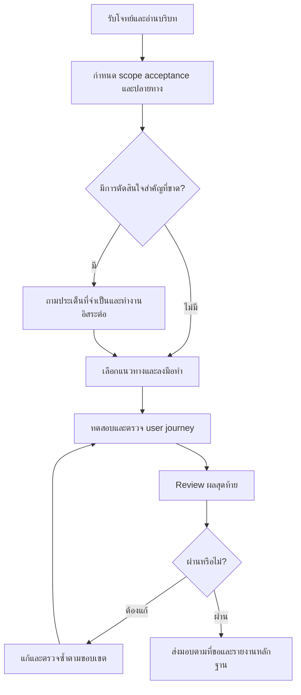

# คู่มือ Lean Skills

คู่มือนี้อธิบายวิธีใช้ชุด 16 skills ใน repository นี้ตามสถานการณ์จริง ถ้ายังไม่ได้ติดตั้ง
เริ่มที่ [README ภาษาไทย](../README.th.md)

## ทำอะไรได้

Lean Skills เป็น **ชุดคำสั่งสำหรับ coding agent** ไม่ใช่ workflow engine และไม่ใช่เครื่องรับประกันผล
แต่ละ skill ใช้เดี่ยวได้ ส่วน agent ต้องมีเครื่องมือ สิทธิ์ และบริบทที่งานนั้นต้องใช้

คุณบอกผลลัพธ์ที่ต้องการ agent เลือกขั้นตอนที่จำเป็น ลงมือ ตรวจ และรายงานพร้อมหลักฐาน
งานจบตาม **ขอบเขตที่คุณขอ** ไม่เกินและไม่ขาด

## เริ่มต้น

ติดตั้ง Node.js/npm และ agent ก่อน แล้วรันจาก root ของโปรเจกต์เป้าหมาย:

```sh
npx skills add aussadawut-dev/lean-skills --skill '*' -a codex claude-code -y
```

- เพิ่ม `-g` หากต้องการติดตั้งระดับ global
- หลัง `-a` เลือกเฉพาะ agent ที่ใช้
- ถ้า agent ยังไม่พบ skill ให้เริ่ม session ใหม่
- ตรวจ scope และไฟล์ที่เพิ่มก่อน commit

ทางเลือกและข้อควรระวังอื่นอยู่ใน [README ภาษาไทย](../README.th.md)
ตัวอย่างในคู่มือนี้ใช้ `$skill-name` ของ Codex ส่วน Claude Code ใช้ `/skill-name`
หรือบอกชื่อ skill เป็นข้อความกับ agent อื่นที่รองรับ

## เลือกเส้นทางตามสถานการณ์

- **ต้องการ feature เต็ม** ใช้ `lean-run` แล้วปล่อยให้มันไล่ต่อเอง: สำรวจและตัดสินใจเท่าที่จำเป็น
  → implement → ทดสอบ journey → review → gate → ส่งมอบ
- **ต้องการแผนเท่านั้น** ใช้ `lean-scope` → `lean-grill` → `lean-research` เมื่อเกี่ยวข้อง
- **มี diff อยู่แล้ว** ใช้ `lean-review` → แก้ข้อพบ → `lean-gate`
- **เพิ่งเริ่มดูแล repo** ใช้ `lean-init` แล้วต่อด้วย `lean-instructions` เมื่อต้องการไฟล์คำสั่ง
- **ดูแลชุด skills เอง** ใช้ `lean-update` ซึ่งแยกจากงานพัฒนาแอป

ลำดับเหล่านี้เป็นตัวอย่าง ไม่ใช่ข้อบังคับ

## lean-run: จากโจทย์ถึงส่งมอบ

`lean-run` รับผิดชอบงานตั้งแต่กำหนดผลลัพธ์จนตรวจและส่งมอบตามที่ขอ ใช้ companion เฉพาะเมื่อมีประโยชน์
และทำขั้นตอนหลักเองได้เมื่อไม่มี companion คุณไม่ต้องเรียกทุกตัว และไม่ต้องรัน `lean-init` ก่อนเสมอ



แต่ละช่วงอาจเรียก companion ต่อไปนี้:

| ช่วง | สิ่งที่เกิดขึ้น | Companion ที่อาจใช้ |
| --- | --- | --- |
| เตรียม | เลือก repo สำรวจคำสั่งและขอบเขต | `lean-target`, `lean-init`, `lean-scope` |
| ตัดสินใจ | ตรวจข้อกำหนดและหาหลักฐานที่จำเป็น | `lean-grill`, `lean-research` |
| ลงมือ | แก้และทดสอบ แบ่งงานเมื่อได้รับอนุญาตและมีประโยชน์ | `lean-task`, `lean-agents` |
| ตรวจและส่งมอบ | ตรวจ user journey, diff, acceptance และปลายทาง | `lean-review`, `lean-gate` |
| ขอบเขตความปลอดภัย | ประเมินกรณีใช้ผิดสิทธิ์และยืนยันการแก้ตามงาน | `lean-security` |
| ปล่อยระบบและกู้คืน | ตรวจ artifact, migration, สุขภาพระบบ และ recovery | `lean-release` |
| ตามคำขอเฉพาะ | จัดการคำสั่ง repo ระดับ root หรือความละเอียดขั้นตอน | `lean-instructions`, `lean-effort` |
| ดูแลชุดเครื่องมือ | อัปเดต skills หรือประเมิน model config | `lean-update`, `lean-model-update` |

### การทดสอบต้องตรงงาน

unit tests หรือ build อย่างเดียวไม่ยืนยัน live integration ที่ยังไม่ได้ลอง agent ต้องบอกว่าส่วนใดจำลอง
และส่วนใดตรวจไม่ได้

ความเข้มของ review ขึ้นกับระดับงาน:

- **LOW** ใช้ self-check
- **MEDIUM** ตรวจ correctness และ regression
- **HIGH** ต้องมี reviewer อิสระตามเงื่อนไขของ skill หากจำเป็นแต่ไม่มีเครื่องมือ ให้รายงาน `BLOCKED`

### ตัวอย่าง: feature ใน VibeCart

```text
$lean-run เพิ่มรายการสินค้าโปรดใน VibeCart
ผู้ใช้เพิ่มและลบสินค้าได้ และรายการต้องอยู่หลังเปิดแอปใหม่
รักษาข้อมูลสินค้าเดิม ตรวจ flow เพิ่ม เปิดแอปใหม่ และลบ
ส่งมอบเป็น PR
```

agent ควรตรวจโครงสร้างและวิธีเก็บข้อมูล ระบุ acceptance ตัดสินใจจากหลักฐาน และถามเรื่องที่มีผลสำคัญ
หากยังไม่ชัด จากนั้น implement ตรวจการใช้งาน และส่ง PR ตามสิทธิ์ ถ้าตรวจการเปิดแอปจริงไม่ได้
ให้รายงานขอบเขตที่ตรวจได้ ไม่สรุปว่าผ่านจาก unit test อย่างเดียว

### ตัวอย่าง: bug และแผนเท่านั้น

```text
$lean-run แก้ปุ่ม Save ใน Settings ที่กดแล้วไม่บันทึก
แสดงบั๊กก่อนแก้และตรวจว่าค่ายังอยู่หลังเปิดแอปใหม่
```

```text
$lean-run วิเคราะห์ทางเลือกจัดเก็บรายการโปรด เสนอแผนและข้อแลกเปลี่ยน
ยังไม่ต้องแก้ไฟล์
```

คำขอแผนเท่านั้นจบที่แผน ส่วนคำขอ implement ที่ชัดเจน agent ทำต่อเอง โดยไม่ต้องรอให้คุณเรียก skill ถัดไป

## เลือกใช้ skills

**รับผิดชอบงานทั้งหมด**

- **`lean-run`**: รับผิดชอบงานครบ flow
  `$lean-run แก้ Save และตรวจ flow จนส่ง PR`

**ตัดสินใจว่าจะทำอะไร**

- **`lean-scope`**: กำหนดขอบเขตและ acceptance
  `$lean-scope กำหนดขอบเขตระบบสินค้าโปรด`
- **`lean-grill`**: ตรวจช่องว่างของ requirement และการตัดสินใจ
  `$lean-grill ตรวจสิทธิ์และอายุข้อมูลในแผนนี้`
- **`lean-research`**: เปรียบเทียบแนวทางจากหลักฐาน
  `$lean-research เปรียบเทียบ SQLite กับ JSON สำหรับงานนี้`

**ลงมือและตรวจงาน**

- **`lean-task`**: วินิจฉัยบั๊ก หรือทำ implementation พร้อมตรวจผล
  `$lean-task แก้ Save และทดสอบการบันทึก`
- **`lean-agents`**: แบ่งงานอิสระให้ agent ที่มีอยู่
  `$lean-agents แบ่งตรวจ retry กับการเก็บสถานะ`
- **`lean-review`**: ตรวจ diff และ regression
  `$lean-review ตรวจ diff ระบบสินค้าโปรด`
- **`lean-gate`**: ตรวจหลักฐานว่าพร้อมปิดงานหรือไม่
  `$lean-gate ตรวจ acceptance และความพร้อมส่ง PR`
- **`lean-effort`**: กำหนดความละเอียดของขั้นตอน มีค่า standard, high, ultra และ reset
  เปลี่ยนความลึกของขั้นตอนเท่านั้น ไม่เปลี่ยน model หรือ reasoning effort
  `$lean-effort high`

**งานเฉพาะทาง**

- **`lean-security`**: ตรวจ security เฉพาะขอบเขต หรือยืนยันการแก้
  `$lean-security ตรวจสิทธิ์อ่านข้อมูลข้ามบัญชี ยังไม่แก้ไฟล์`
- **`lean-release`**: วางแผนหรือทำ release/recovery ตามคำขอ
  `$lean-release วางแผนปล่อย staging พร้อมเกณฑ์ rollback ยังไม่ deploy`
- **`lean-model-update`**: ประเมินและเสนอปรับ model mapping ต้องได้รับอนุมัติข้อเสนอที่แน่นอน
  ก่อนแก้ configuration
  `$lean-model-update เสนอแผนประเมิน model และงบ`

**ตั้งค่าและดูแลชุด skills**

- **`lean-init`**: สำรวจ repo คำสั่ง และแนวทางทำงาน
  `$lean-init สำรวจโปรเจกต์และคำสั่งทดสอบ`
- **`lean-instructions`**: สร้างหรืออัปเดตคำสั่งที่ root แก้เฉพาะไฟล์ที่ root ของ repository
  กฎในโฟลเดอร์ย่อยอ่านเป็นบริบทได้แต่ไม่แก้
  `$lean-instructions อัปเดต AGENTS.md และ CLAUDE.md`
- **`lean-target`**: เลือกหรือเตรียม repo เป้าหมาย
  `$lean-target ใช้ /path/to/project สำหรับงานนี้`
- **`lean-update`**: อัปเดตชุด skills ใน scope เดิม
  `$lean-update อัปเดต Lean skills ทั้งชุดในโปรเจกต์นี้`

`lean-update` v1.3.0 เปรียบเทียบ inventory และเพิ่ม skill ที่ขาดใน scope เดิม ถ้าสั่งเฉพาะชื่อ
จะจำกัดเฉพาะชื่อนั้น กรณีมี local edits หรือชื่อชนกัน ต้องรักษาไว้และรายงาน conflict
`lean-update` เวอร์ชันเก่าต้องอัปเดตตัวเองก่อนจึงจะใช้พฤติกรรมนี้ได้

## จบงานตามขอบเขตและส่งต่อได้

ทุก skill สรุปผลที่ตรงคำขอ พร้อมหลักฐาน ข้อจำกัด และสิ่งที่ต้องทำต่อ งานสำรวจหรือวินิจฉัยอย่างเดียว
จบได้โดยไม่แก้แอป ผลลัพธ์จบด้วยสถานะหนึ่งตัว และระบุว่าเป็นสถานะของการประเมิน การส่งต่องาน
หรือ implementation/release

- **`READY`**: แผนพร้อม ใช้ `READY_WITH_ASSUMPTIONS` เมื่อเหลือเพียงสมมติฐานที่ย้อนกลับได้
- **`PASS`** / **`REWORK`**: ผลของ review
- **`DONE`**: endpoint ที่ขอครบจริง ทั้ง acceptance, checks, review และปลายทางที่ตกลง
- **`BLOCKED`**: ขาดสิ่งจำเป็น
- **`FAILED`**: ลงมือแล้วยังมีความล้มเหลวที่ยืนยันแล้วและแก้ไม่ได้

`PASS` ของ review และ `READY` ของ scope เป็นผลของขั้นนั้นเท่านั้น ไม่ได้แปลว่างานทั้งหมดเสร็จ

งานแต่ละแบบมีวิธีจบของตัวเอง:

- **Debug:** `lean-task` ใช้เอกสารวินิจฉัยเมื่อสาเหตุยังไม่ชัด เก็บ expected/actual ทำซ้ำ ลดกรณี
  ไล่หาจุดที่เริ่มเสีย และใช้ probe แยกสมมติฐาน งาน diagnosis-only ไม่แก้แอป
- **UX:** `lean-scope` กำหนด acceptance จากเป้าหมายผู้ใช้ รวม keyboard/focus, feedback และ states
  ที่เกี่ยวข้อง แล้วใช้ข้อตกลงเดียวกันใน task และ review โดยแยกสิ่งที่อ่านจาก source ออกจากสิ่งที่ลอง
  ใน browser หรือ assistive technology จริง
- **Security:** `lean-security` ไล่ข้อมูล จุดรับ input และการข้ามขอบเขตสิทธิ์ ตรวจทั้งกรณีที่อนุญาต
  และปฏิเสธในสภาพแวดล้อมที่ได้รับอนุญาต พร้อมข้อพบที่ตรวจสอบได้
- **Release:** `lean-release` แยกแผนกับการลงมือ ตรวจเวอร์ชันและ target จริง เตรียม recovery
  ตามผลต่อข้อมูล และตรวจหลัง deploy หาก release ล้มเหลวแต่กู้คืนได้ ต้องรายงาน release เป็น `FAILED`
  และ recovery เป็น `DONE` แยกกัน
- **Handoff:** ขอให้ `lean-run` เตรียมส่งต่องานได้ โดยระบุ repo, revision, ไฟล์ที่ค้าง, decisions,
  evidence, งานที่ยังไม่ทราบผล และ repair count เมื่อเริ่มใหม่ ต้องเทียบสภาพจริงก่อนใช้ผลตรวจเก่า
  หรือทำ mutation ซ้ำ และไม่สร้าง checkpoint ถาวรโดยไม่ได้ขอ

ตัวอย่าง: `$lean-run เตรียม handoff ของงานนี้ในแชท ยังไม่แก้ไฟล์ต่อ`
ผล handoff อาจเป็น `DONE` ขณะที่งานแอปยัง `BLOCKED` รายงานต้องอธิบายทั้งสองขอบเขต

## สัญญาณว่าใช้ได้ผล

- คุณเรียก skill เดียวแล้ว agent ไล่ขั้นตอนถัดไปเอง โดยถามเฉพาะเรื่องที่มีผลสำคัญ
- รายงานแยกสิ่งที่รันจริง สิ่งที่จำลอง และสิ่งที่ตรวจไม่ได้
- คำขอแผนเท่านั้นจบที่แผน โดยไม่มีไฟล์ถูกแก้
- สถานะสุดท้ายบอกชัดว่าเป็นของขอบเขตใด

## คำถามที่พบบ่อย

**ต้องรัน `lean-init` ก่อนทุกครั้งไหม**
ไม่ต้อง `lean-run` สำรวจเท่าที่จำเป็นเอง ใช้ `lean-init` เมื่อต้องการสำรวจ repo เป็นงานแยก

**unit tests ผ่านแล้ว ถือว่าเสร็จได้ไหม**
ไม่เสมอ ถ้างานมี live integration หรือ user journey ที่ยังไม่ได้ลอง agent ต้องรายงานส่วนนั้นเป็นข้อจำกัด

**ถ้าต้องการ reviewer อิสระแต่ไม่มีเครื่องมือ**
งานระดับ HIGH จะได้ `BLOCKED` พร้อมบอกว่าขาดอะไร

**`lean-effort` กับ reasoning effort ของโมเดลต่างกันอย่างไร**
`lean-effort` กำหนดความลึกของขั้นตอน ส่วน model และ reasoning effort เลือกแยกตอนแบ่งงาน

## อ่านต่อ

- [README ภาษาไทย](../README.th.md): การติดตั้ง โหมด Auto/Manual และการแบ่งงานให้โมเดลอื่น
- [Protocol การทดสอบพฤติกรรม](evaluation.md): ใช้เมื่อต้องการทดลองพฤติกรรมของ agent
  โดยแยกผลที่รันจริงออกจากกรณีที่ยังไม่รัน
