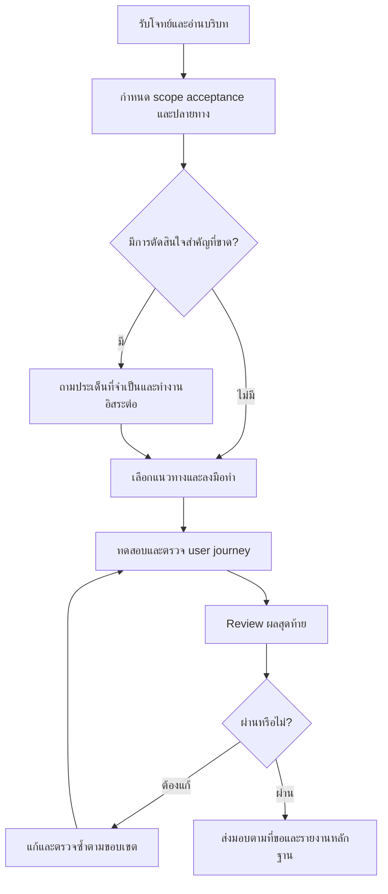

# คู่มือ Lean Skills

Lean Skills เป็นชุดคำสั่งสำหรับ coding agent ไม่ใช่ workflow engine หรือเครื่องรับประกันผล แต่ละ skill ใช้เดี่ยวได้ และ agent ต้องมีเครื่องมือ สิทธิ์ และบริบทที่งานนั้นต้องใช้ คู่มือนี้อ้างอิงชุด 14 skills ใน repository นี้

## เริ่มต้น

ติดตั้ง Node.js/npm และ agent ก่อน จาก root ของโปรเจกต์เป้าหมาย:

```sh
npx skills add aussadawut-dev/lean-skills --skill '*' -a codex claude-code -y
```

เพิ่ม `-g` หากต้องการติดตั้งระดับ global เลือก `-a` เฉพาะ agent ที่ใช้ ดูทางเลือกและข้อควรระวังใน [README ภาษาไทย](../README.th.md) หลังติดตั้งให้เริ่ม session ใหม่หาก agent ยังไม่พบ skill ตรวจ scope และไฟล์ที่เพิ่มก่อน commit

ตัวอย่างด้านล่างใช้ `$skill-name` ใน Codex; Claude Code ใช้ `/skill-name` หรือบอกชื่อ skill เป็นข้อความกับ agent ที่รองรับ

## lean-run: จากโจทย์ถึงส่งมอบ

`lean-run` เป็นผู้รับผิดชอบงานตั้งแต่กำหนดผลลัพธ์จนตรวจและส่งมอบตามที่ขอ ใช้ companion เฉพาะเมื่อมีประโยชน์ และทำขั้นตอนหลักเองได้เมื่อไม่มี companion ไม่ต้องเรียกทุกตัวหรือรัน `lean-init` ก่อนเสมอ



| ช่วง | สิ่งที่เกิดขึ้น | Companion ที่อาจใช้ |
| --- | --- | --- |
| เตรียม | เลือก repo สำรวจคำสั่งและขอบเขต | `lean-target`, `lean-init`, `lean-scope` |
| ตัดสินใจ | ตรวจข้อกำหนดและหาหลักฐานที่จำเป็น | `lean-grill`, `lean-research` |
| ลงมือ | แก้และทดสอบ แบ่งงานเมื่อได้รับอนุญาตและมีประโยชน์ | `lean-task`, `lean-agents` |
| ตรวจและส่งมอบ | ตรวจ user journey, diff, acceptance และปลายทาง | `lean-review`, `lean-gate` |
| ตามคำขอเฉพาะ | จัดการคำสั่ง repo ระดับ root หรือความละเอียดขั้นตอน | `lean-instructions`, `lean-effort` |
| ดูแลชุดเครื่องมือ | อัปเดต skills หรือประเมิน model config | `lean-update`, `lean-model-update` |

การทดสอบต้องตรงงาน: unit tests หรือ build เพียงอย่างเดียวไม่ยืนยัน live integration ที่ยังไม่ได้ลอง บอกสิ่งที่จำลองและสิ่งที่ตรวจไม่ได้ Review ระดับ LOW ใช้ self-check, MEDIUM ตรวจ correctness/regression, HIGH ต้องมี reviewer อิสระตามเงื่อนไขของ skill หากจำเป็นแต่ไม่มีเครื่องมือให้รายงาน BLOCKED

`DONE` หมายถึง acceptance, checks, review และปลายทางที่ตกลงครบ; `BLOCKED` คือขาดสิ่งจำเป็น; `FAILED` คือมีความล้มเหลวที่ยืนยันแล้วและยังไม่แก้ `PASS` ของ review และ `READY` ของ scope เป็นเพียงผลของขั้นนั้น

### ตัวอย่าง feature ใน VibeCart

```text
$lean-run เพิ่มรายการสินค้าโปรดใน VibeCart
ผู้ใช้เพิ่มและลบสินค้าได้ และรายการต้องอยู่หลังเปิดแอปใหม่
รักษาข้อมูลสินค้าเดิม ตรวจ flow เพิ่ม เปิดแอปใหม่ และลบ
ส่งมอบเป็น PR
```

Agent ควรตรวจโครงสร้างและวิธีเก็บข้อมูล ระบุ acceptance ตัดสินใจจากหลักฐาน ถามเรื่องที่มีผลสำคัญหากยังไม่ชัด แล้ว implement ตรวจการใช้งานและส่ง PR ตามสิทธิ์ ถ้าตรวจการเปิดแอปจริงไม่ได้ให้รายงานขอบเขต ไม่สรุปว่าผ่านจาก unit test อย่างเดียว

### ตัวอย่าง bug และตัวอย่างแผนเท่านั้น

```text
$lean-run แก้ปุ่ม Save ใน Settings ที่กดแล้วไม่บันทึก
แสดงบั๊กก่อนแก้และตรวจว่าค่ายังอยู่หลังเปิดแอปใหม่
```

```text
$lean-run วิเคราะห์ทางเลือกจัดเก็บรายการโปรด เสนอแผนและข้อแลกเปลี่ยน
ยังไม่ต้องแก้ไฟล์
```

คำขอแผนเท่านั้นจบที่แผน คำขอ implement ที่ชัดเจนให้ทำงานต่อ ไม่ต้องรอให้ผู้ใช้เรียก skill ถัดไป

## เลือกใช้ skills

| Skill | ใช้เมื่อ | ตัวอย่างคำสั่ง |
| --- | --- | --- |
| `lean-run` | รับผิดชอบงานครบ flow | `$lean-run แก้ Save และตรวจ flow จนส่ง PR` |
| `lean-init` | สำรวจ repo คำสั่งและแนวทางทำงาน | `$lean-init สำรวจโปรเจกต์และคำสั่งทดสอบ` |
| `lean-instructions` | สร้าง/อัปเดตคำสั่งที่ root | `$lean-instructions อัปเดต AGENTS.md และ CLAUDE.md` |
| `lean-scope` | กำหนดขอบเขตและ acceptance | `$lean-scope กำหนดขอบเขตระบบสินค้าโปรด` |
| `lean-grill` | ตรวจช่องว่างของ requirement และการตัดสินใจ | `$lean-grill ตรวจสิทธิ์และอายุข้อมูลในแผนนี้` |
| `lean-research` | เปรียบเทียบแนวทางจากหลักฐาน | `$lean-research เปรียบเทียบ SQLite กับ JSON สำหรับงานนี้` |
| `lean-task` | ทำ implementation task พร้อมตรวจผล | `$lean-task แก้ Save และทดสอบการบันทึก` |
| `lean-agents` | แบ่งงานอิสระให้ agent ที่มีอยู่ | `$lean-agents แบ่งตรวจ retry กับการเก็บสถานะ` |
| `lean-review` | ตรวจ diff และ regression | `$lean-review ตรวจ diff ระบบสินค้าโปรด` |
| `lean-gate` | ตรวจหลักฐานว่าพร้อมปิดงานหรือไม่ | `$lean-gate ตรวจ acceptance และความพร้อมส่ง PR` |
| `lean-effort` | กำหนดความละเอียดของขั้นตอน | `$lean-effort high` |
| `lean-target` | เลือกหรือเตรียม repo เป้าหมาย | `$lean-target ใช้ /path/to/project สำหรับงานนี้` |
| `lean-update` | อัปเดตชุด skills ใน scope เดิม | `$lean-update อัปเดต Lean skills ทั้งชุดในโปรเจกต์นี้` |
| `lean-model-update` | ประเมินและเสนอปรับ model mapping | `$lean-model-update เสนอแผนประเมิน model และงบ` |

`lean-effort` มี standard, high, ultra และ reset; เปลี่ยนความลึกของขั้นตอน ไม่ได้เปลี่ยน model หรือ reasoning effort ส่วน `lean-model-update` ต้องได้รับการอนุมัติข้อเสนอที่แน่นอนก่อนแก้ configuration

`lean-instructions` แก้เฉพาะไฟล์ที่ root ของ repository; อ่านกฎในโฟลเดอร์ย่อยเป็นบริบทได้แต่ไม่แก้ การอัปเดตชุดด้วย `lean-update` v1.3.0 เปรียบเทียบ inventory และเพิ่ม skill ที่ขาดใน scope เดิม หากสั่งเฉพาะชื่อจะจำกัดเฉพาะชื่อนั้น กรณี local edits หรือชื่อชนกันต้องรักษาไว้และรายงาน conflict เวอร์ชันเก่าของ `lean-update` ต้องได้รับการอัปเดตก่อนจึงใช้พฤติกรรมใหม่นี้ได้

## ลำดับที่พบบ่อย

- Feature เต็ม: `lean-run` → สำรวจและตัดสินใจเท่าที่จำเป็น → implement → ทดสอบ journey → review → gate → ส่งมอบ
- ขอแผนเท่านั้น: `lean-scope` → `lean-grill` → `lean-research` เมื่อเกี่ยวข้อง
- มี diff แล้ว: `lean-review` → แก้ข้อพบ → `lean-gate`
- เริ่มดูแล repo: `lean-init` → `lean-instructions` เมื่อผู้ใช้ต้องการไฟล์คำสั่ง
- บำรุงรักษาสกิล: `lean-update` แยกจากการพัฒนาแอป

ลำดับเหล่านี้เป็นตัวอย่าง ไม่ใช่ข้อบังคับ หากต้องการทดลองพฤติกรรมของ agent ให้ใช้ [protocol การทดสอบ](../tests/behavioral.md) และแยกผลที่รันจริงจากกรณีที่ยังไม่รัน
